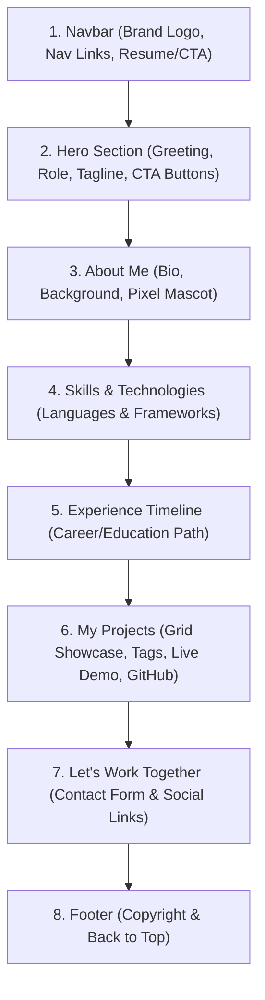

# Product Requirements Document (PRD)
## Personal Portfolio Web Application (Dark Cyber / Violet Aesthetic)

---

## 1. Executive Summary & Overview
Dokumen ini merupakan panduan spesifikasi teknis dan alur implementasi pembuatan website portofolio pribadi bertema **Modern Dark Cyber / Aesthetic Violet** yang terinspirasi dari referensi visual yang diberikan. 

Website ini dirancang untuk menampilkan identitas personal, riwayat keahlian (programming languages & frameworks), showcase portofolio proyek, serta media kontak dan tautan sosial media (GitHub, YouTube, Instagram, Email).

---

## 2. Tech Stack & Architectural Decision

### 2.1 Pilihan Frontend & UI
* **Styling Framework**: **Tailwind CSS** (via CDN / compiled)
  * *Alasan*: Sangat ideal untuk membangun antarmuka dark mode dengan warna neon purple/violet (`#8B5CF6`, `#A855F7`, `#09090B`), efek border glow, flexbox/grid responsif, serta animasi transisi halus tanpa bloat CSS manual.
* **Markup & Scripting**: **Modern Semantic HTML5 & Vanilla JavaScript**
  * Struktur clean, modular, dan langsung menghasilkan file `index.html` di root project.
  * Interaksi interaktif: smooth scroll navigation, mobile menu toggle, dan copy email/contact form handling.
* **Typography**: Modern Sans-Serif (`Instrument Sans` / `Inter`) & Fira Code / JetBrains Mono (untuk badge tech).
* **Icons & Mascot**: Font Awesome / Lucide Icons SVG + Custom SVG Pixel Art (maskot kucing ungu 8-bit).

### 2.2 Strategi Deployment: GitHub Pages Native
> [!TIP]
> **Keputusan Arsitektur: Native GitHub Pages Deployment**
> * Berdasarkan keputusan bahwa prioritas utama adalah **kemudahan akses publik, performa kilat, dan zero-cost hosting** di GitHub Pages (`username.github.io`), arsitektur web portofolio ini dibangun secara **Native Static Web (HTML5 + Tailwind CSS)**.
> * **Keunggulan untuk GitHub Pages:**
>   1. **Zero Setup Hosting**: Cukup push ke repository GitHub, aktifkan GitHub Pages dari Settings -> Pages -> Deploy from Branch `main` (Root). Website langsung live dalam hitungan detik.
>   2. **Super Cepat & Reliable**: Tidak ada waktu *cold start* / server tertidur seperti pada hosting gratisan PHP (Render/Glitch/dll).
>   3. **100% Mobile & Recruiter Friendly**: Sangat ringan dan responsif dibuka di browser manapun.
> * **Formulir Kontak**: Menggunakan integrasi **Formspree / Web3Forms** atau tombol aksi langsung `mailto:`, sehingga siapapun yang mengirim pesan langsung terkirim ke kotak masuk email personal tanpa memerlukan backend database.

---

## 3. Fitur & Struktur Halaman

Website dirancang sebagai **Single Page Application (SPA) Portfolio** dengan smooth scrolling ke tiap section:

### 3.1 Rincian Setiap Bagian (Section Breakdown)

#### A. Header / Navigation Bar
* **Brand Logo**: Teks bergaya kaligrafi atau font modern (`alvinoaldorino`).
* **Navigation Links**: Home, About, Skills, Projects, Contact (dengan smooth scrolling ID anchor `#about`, `#projects`, dll).
* **Mobile Menu**: Tombol hamburger responsif untuk tampilan layar smartphone.

#### B. Hero Section
* **Status Badge**: *"Available for new Projects"* (kapsul pill ungu gelap dengan border neon dan titik pulsasi hijau/ungu).
* **Headline**: *"Hey! , I am [Nama Kamu]"* (teks nama dengan aksen gradient ungu-ke-pink).
* **Role Subtitle**: *"Full-Stack Developer"* / *"Software Engineer"*.
* **Bio Ringkas**: Kalimat pembuka profesional yang menarik klien/recruiter.
* **CTA Buttons**:
  * Tombol 1 (Primary): *"View My Work"* (scroll halus ke section `#projects`).
  * Tombol 2 (Secondary): *"Get in Touch"* (scroll halus ke section `#contact`).

#### C. About Me Section
* **Kolom Kiri**: Paragraf pengenalan diri, filosofi clean code, minat teknologi, dan antusiasme belajar hal baru.
* **Kolom Kanan**: Aksen grafis pixel-art maskot (kucing ungu 8-bit dengan ornamen bintang/sparkle) untuk mempertahankan estetika seperti referensi desain.

#### D. Skills & Technologies
Dikelompokkan ke dalam kartu kategori bergradasi gelap:
1. **Core Languages (Bahasa Pemrograman Terpahami)**:
   * Misal: PHP, JavaScript, Python, TypeScript, HTML5, CSS3, SQL.
2. **Frameworks & Libraries**:
   * Misal: Laravel, Tailwind CSS, Bootstrap, Vue.js / React, Express.js.
3. **Tools & Database**:
   * Misal: MySQL, Git, GitHub, Postman, Vite, Laragon/Docker.

#### E. Experience / Journey Timeline
* Garis vertikal interaktif dengan badge lingkaran tahun (contoh: 2024, 2025, 2026).
* Informasi posisi/role, nama instansi/perusahaan/kampus, dan deskripsi pencapaian/tugas.

#### F. My Projects Section
* **Grid Layout**: 3 kolom di desktop, 2 kolom di tablet, 1 kolom di HP.
* **Item Kartu Proyek**:
  * Thumbnail mockup proyek (gambar resolusi baik).
  * Judul proyek (misal: *E-Commerce App*, *Chat System*, *Company Profile*).
  * Deskripsi ringkas fungsionalitas aplikasi.
  * Tag badges teknologi (misal: `Laravel`, `Tailwind`, `MySQL`).
  * Action Links: Tombol *"View Details"* / *"Live Demo"* dan tombol ikon *"GitHub Repository"*.

#### G. Let's Work Together (Contact & Social Links)
* **Kolom Kiri (Contact Form)**:
  * Input Nama (*Name*)
  * Input Email (*Email*)
  * Input Pesan (*Message*)
  * Tombol Submit *"Send Message"* bergradasi ungu neon.
* **Kolom Kanan (Informasi & Social Media)**:
  * Teks ajakan kolaborasi/kerja sama.
  * List layanan yang ditawarkan (Web Development, UI/UX Design, dll).
  * **Baris Ikon Sosial Media Interaktif**:
    * **GitHub**: Link ke profil GitHub.
    * **YouTube**: Link ke channel YouTube.
    * **Instagram**: Link ke akun Instagram.
    * **Email**: Tautan `mailto:` langsung.

---

## 4. Panduan Desain & Style Guide

| Elemen | Nilai / Spesifikasi |
| :--- | :--- |
| **Background Utama** | `#09090b` (Deep Dark Zinc) / `#0d0b14` (Deep Night Purple) |
| **Card Background** | `#13111c` / `#18181b` dengan border `rgba(168, 85, 247, 0.15)` |
| **Primary Accent** | `#8B5CF6` (Violet 500) & `#A855F7` (Purple 500) |
| **Glow Effects** | `box-shadow: 0 0 25px -5px rgba(168, 85, 247, 0.3)` |
| **Text Primary** | `#FFFFFF` / `#F4F4F5` |
| **Text Muted** | `#A1A1AA` (Zinc 400) |
| **Border Radius** | `rounded-2xl` & `rounded-xl` (modern soft curved) |

---

## 5. Rencana Tahapan Eksekusi (Implementation Roadmap)

### Tahap 1: Setup Struktur File & Library
1. Membuat file utama `index.html` yang terstruktur rapi dan semantik di root project.
2. Integrasi **Tailwind CSS**, font modern (`Plus Jakarta Sans` / `Inter` / `Space Grotesk`), dan icon pack.
3. Menyiapkan palet tema warna khusus (Dark Background, Neon Violet/Purple, Glow effects).

### Tahap 2: Pembangunan Komponen & Section Visual
1. **Header & Sticky Navbar**: Brand name, menu links dengan smooth-scrolling, dan hamburger menu mobile responsif.
2. **Hero Section**: Status pill badge "Available for new Projects", gradient text headline, bio profesional, dan dual CTA buttons.
3. **About Me**: Narasi personal + integrasi maskot pixel-art kucing ungu (SVG pixel art murni tanpa dependensi luar).
4. **Skills & Technologies**: Grid kartu kategori (Core Languages, Frameworks, Database & Tools) dengan tag badges beraksen ungu.
5. **Experience Timeline**: Garis vertikal berantai dengan penanda tahun dan kartu riwayat aktivitas/pekerjaan.
6. **My Projects Grid**: Kartu showcase proyek (gambar mockup, tech stack tags, tombol Demo & GitHub).
7. **Let's Work Together & Socials**: Formulir pesan (Name, Email, Message) dan deretan tombol sosial media (GitHub, YouTube, Instagram, Email).

### Tahap 3: Interaktivitas & Responsivitas
1. Script interaktif ringan (JavaScript murni):
   - Hamburger menu untuk layar smartphone.
   - Smooth scroll ke setiap section saat menu navigasi diklik.
   - Efek hover glow interaktif pada kartu proyek dan skill.
2. Penyesuaian tampilan responsif di mobile (360px - 480px), tablet (768px), dan desktop (1024px+).

### Tahap 4: Panduan Deploy ke GitHub Pages
1. Inisialisasi Git dan commit file ke GitHub.
2. Pengaktifan fitur **GitHub Pages** melalui menu *Repository Settings -> Pages -> Deploy from a branch (`main` / root)*.
3. Website langsung aktif dan dapat diakses publik di URL `https://<username>.github.io/<repo-name>`.

---

## 6. Checklist Verifikasi & Quality Assurance
- [ ] Tampilan visual identik dengan tema referensi (Dark + Violet Glow).
- [ ] Section *About Me* memuat deskripsi personal dan maskot pixel.
- [ ] Section *Skills* membedakan bahasa pemrograman dan framework dengan rapi.
- [ ] Section *Projects* menampilkan mockup gambar, tags, dan link GitHub/Demo yang bisa diklik.
- [ ] Link sosial media (GitHub, YouTube, Instagram, Email) berfungsi dengan benar di tab baru.
- [ ] 100% responsif pada layar smartphone dan laptop.
- [ ] Hasil build statis sukses tayang di GitHub Pages tanpa error 404 pada aset CSS/JS.
